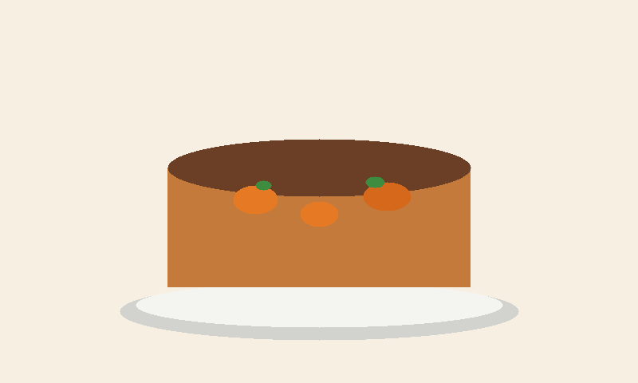

Esse bolo eu faço quando aparece visita. A cobertura é o que a galera mais come.

## Ingredientes

- 3 cenouras médias
- 3 ovos
- 1 xícara de óleo
- 2 xícaras de açúcar
- 2 xícaras de farinha de trigo
- 1 colher de fermento

Cobertura: 3 colheres de chocolate em pó, 1 colher de manteiga, 1 xícara de açúcar e um pouco de leite.

## Modo de fazer

Bate a cenoura, o ovo e o óleo no liquidificador. Mistura a farinha e o açúcar, põe o fermento por último e leva ao forno, mais ou menos 40 minutos a 180 graus.

A cobertura vai no fogo até engrossar e depois despeja em cima do bolo ainda quente.
